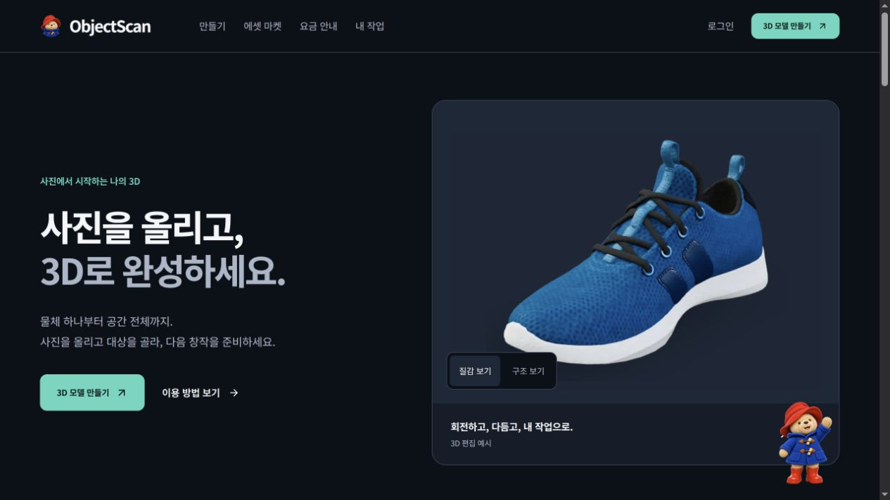
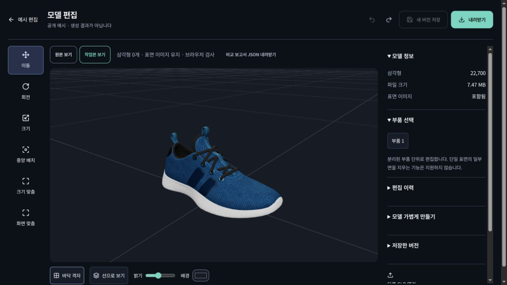
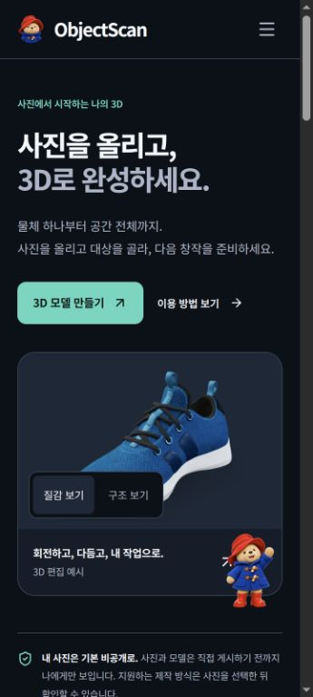

# 팀 티켓 재감사 및 배포 복구 — 2026-11-16

## 결론

팀원이 기능을 상당 부분 구현했지만 **17개 티켓 모두 완벽하게 완료됐다는 근거는 없다**. 일부는 구현 범위가 남았고, 일부는 Team UI/fixture만 통과해 Owner 실연동이 남았다. 실패한 CI를 우회하거나 mock을 실제 서비스 검증으로 취급하지 않는다.

검토 시작: 로컬 fc20978 → 원격 main1416caf를 fast-forward. 시작 시 사용자 미커밋 변경 없음. 브랜치 이름/문서의 완료 표현 대신 실제 source diff·AC·실행 결과를 비교했다. GitHub 이슈는 조회 시17개 모두 OPEN이었다. 연구/모델 교체 없이 제품 안정화 범위만 수정했다.

## 발견한 배포 문제

1. GitHub Actions43798675627: upload 버튼의 새 이름(장수 포함)을 기존 E2E가 못 찾음. editor status와 version 버튼이 추가되어 기존 locator가 여러 요소와 일치함. selector를 정확한 작업 대상으로 수정하고 실제 저장·원본불변·재열기 검증은 유지했다.
2. CI는 production build를 하고도 E2E에서 dev 서버를 다시 cold compile했다. 이미 만든 production build를 실행해 검증하도록 바꿨다. 로컬 dev startup120s timeout과 배포 환경의 차이도 구분한다.
3. Team fixture suite가 기존 CI에 포함되지 않음. 키 없는 team-ui job을 추가하고 platform/team outputDir를 분리해 병렬 trace/산출물 삭제 충돌을 방지했다.
4. Vercel project objectscan(prj_CweIne2ltCHxViOCftiCQkX6nj72)의 link=null, gitRepository=null로 Git 연결이 없었다. 최근4일 신규 배포가 없었다. gitProviderOptions.createDeployments=disabled도 관찰했으나 공식 OpenAPI상 GitHub deployment 레코드 생성 옵션이므로 Vercel 빌드 차단 원인으로 단정하지 않는다. main push와 실제 배포는 다른 상태였다.
5. CLI Git connect가 접근 오류로 거부됨. Vercel dashboard 로그인을 요청했다. 권한을 임의 확대하거나 토큰을 추출해 우회하지 않는다. 기존 인증 CLI로 정확 SHA의 staged production을 검증할 수 있는 경로는 별도 진행한다.
6. Production NEXT_PUBLIC_APP_URL이 옛 objectscan-six.vercel.app이었다. be-celeb.org로 config를 갱신했다(새 배포부터 적용). GPU/결제/LIVE/payout 활성화는 변경하지 않는다.

## 이번에 수정한 사용자 결함

- 주문 생성 응답 유실 후 재시도에 같은 idempotency key 사용.
- 프로젝트/업로드 시작 실패 시 memory-only File 선택 유지. 성공 확인 후에만 draft 제거.
- 가입 확인·재발송의 next 보존, 외부 next는 기존 safeNext로 차단.
- 이미지 선택 허용/카피20MB를 실제 서버16MB 제한과 일치.
- 대비를 제외하던 axe 옵션 제거. 해당 화면의 muted text를 디자인 token에 연결하고 전체 화면 검사.
- 실제 editor 비교 JSON·원본 전환·손상 GLB 보존·503 저장 재시도 검증 추가.

## 티켓별 판정

CONDITIONAL은 제한된 코드/fixture/지정 회귀 근거이며 무결점 선언이 아니다. OWNER_PENDING은 팀 구현과 외부 서버 통합을 구분한다. PARTIAL은 팀 범위나 검증 자체가 남았다.

| 티켓  | 담당 | 판정                 | 근거·남은 범위                                                                                                                                                                                                                                                          |
| ----- | ---- | -------------------- | ----------------------------------------------------------------------------------------------------------------------------------------------------------------------------------------------------------------------------------------------------------------------- |
| OS-01 | A    | CONDITIONAL          | generation-availability/use-generation-check/checkout에 실제 health/QA/wallet 계약 사용. 지원불가 차감 없음 및 중복 요청 방지 fixture 추가. 공개 Production의 생성 허용 범위는 별도 gate.                                                                               |
| OS-02 | B    | CONDITIONAL          | 가입 대기·재발송·만료 링크·safeNext 구현. 가입/재발송이 next를 dashboard로 버리던 점을 수정하고 회귀 추가. 외부 SMTP/최종 도메인 allow-list는 OWN-01.                                                                                                                   |
| OS-03 | A    | CONDITIONAL          | abort/backoff/visibility/online/terminal·불명 요청 재조회 구현. 실제 hook을 사용하는 중복 POST/재조회 fixture 추가. 실제 worker 취소/경합은 별도 운영 검증.                                                                                                             |
| OS-04 | B    | OWNER_PENDING        | snapshot 없는 과거 주문을 추측하지 않는 UI 구현. 서버 billing 응답에 snapshot whitelist 필드 연결 미완료(OWN-06). UI mock 성공을 서비스 완료로 볼 수 없음.                                                                                                              |
| OS-06 | A    | CONDITIONAL          | MeshReport 비교·원본/작업본 전환·JSON 내보내기 구현. 실제 GLB 간소화 후 원본22700 triangles/작업본 감소/JSON 및 손상 파일 뒤 기존 모델 유지 회귀 보강.                                                                                                                  |
| OS-07 | B    | PARTIAL              | 순서·제외·선택 경고/helper는 구현. 실제 upload-complete 응답을 wizard 사진 경고로 잇는 경로 미완료. 진단값은 fixture에서만 공급. 업로드 시작 실패 시 File 선택 소실 수정. 선택20MB/서버16MB 불일치 수정.                                                                |
| OS-08 | B    | CONDITIONAL          | 실패→재선택·stale revision→재검토·포커스 구현. 기존404 MASK_NOT_FOUND 계약 재사용. 색 대비 제외로 가려진 화면 결함을 token 적용 후 전체 axe로 재검증.                                                                                                                   |
| OS-09 | A    | PARTIAL              | poster 경로 whitelist·카드 fallback만 구현. 모델 capture→사용자 확인→게시 미리보기 경로는 미구현. OS-19가 이미 통합됐으므로 예전 OS-19 BLOCKED 설명은 더 이상 충분한 차단 사유가 아님. OWN-08 storage API도 대기.                                                       |
| OS-10 | B    | CONDITIONAL          | 서버 paid/refunded 판정·금액/만료·응답 유실 재확인 UI 구현. 주문 생성 응답 유실 후 재시도 키가 바뀌는 결함 수정. actual Toss/환불/ledger 검증은 OWN-03.                                                                                                                 |
| OS-11 | A    | OWNER_PENDING        | 삭제 확인·in-flight guard·409 권리 보존 안내·실패 재시도 구현. 실제 컴포넌트에서 취소 focus 및503→409 유지 fixture 추가. 실제 보관 hold/storage cleanup은 OWN-07.                                                                                                       |
| OS-12 | B    | CONDITIONAL          | env -i Vite shell과 next/Supabase adapter 구현. 미등록 route404. CI에 이 suite가 없던 점을 별도 key-free job으로 보강. 테스트 산출물 디렉터리 분리로 병렬 suite 충돌 방지.                                                                                              |
| OS-17 | A    | PARTIAL              | PrivateModelImportPanel·typed adapter/state/idempotency 설계 구현. Production에는 adapter를 주입하는 호출자가 없으므로 private 저장은 준비 중. helper unit과 기존 GLB editor만으로 mock 개인 저장 전체 AC 통과를 확언할 수 없음. OWN-09 연결/입력검증/rights 확인 남음. |
| OS-18 | B    | CONDITIONAL          | 현재 불러온 목록의 license/price 필터·URL 상태·오류 복구 구현. 서버 전체 목록 필터/새 검색 DB 기능은 아님. Next 실제 배포와 fixture를 구분. 전체 axe의 카드 대비 결함 수정.                                                                                             |
| OS-19 | B    | CONDITIONAL          | Drei Bounds camera preset/fit 구현. 파일 좌표축과 실제 정면을 구분. 실제 public demo GLB로 camera 방향·zoom 복구 검사. 새 AI 기능 아님.                                                                                                                                 |
| OS-20 | A    | PARTIAL_VERIFICATION | 이력 cursor·삭제 확인·dirty/save 실패 복구 구현. 새503 저장 재시도에서 동일 key/원본 불변/정상 version 재열기 회귀 보강. 다중 부품 숨김·삭제·undo 전체 UI 시나리오의 공용 fixture 증거는 아직 불충분.                                                                   |
| OS-21 | B    | CONDITIONAL          | 상태·원장·payout 한국어화, unknown 안전 표시, 환불/다운로드404/재조회 구현. 실제 구매 권한 집행은 기존 server/RLS가 담당하며 Team fixture는 권한 실행 증명이 아님.                                                                                                      |
| OS-22 | B    | PARTIAL              | 기존8과업은 Team B 위주였고 editor와 A 티켓이 누락됐다고 HANDOFF에 명시. A 생성/재조회/삭제 회귀를 공용 suite에 추가하고 접근성 제외 제거. editor/private import 전부를 키 없는 공통 fixture에 옮긴 것은 아니므로 원래 AC 전체 완료 아님.                               |

## 실행 결과

로컬 실행 결과:

- TypeScript/typecheck 통과, lint 오류0·기존 경고7, Prettier 및 디자인 토큰 동기화 검사 통과.
- 단위·DB 통합 테스트82통과/1선택 skip. Worker Python32통과(실제 CUDA 추론 검증 아님).
- production build 통과. production 서버 E2E8통과/1선택 skip(대형 GPU 산출물 fixture 미제공).
- Team UI 최초135건 중132통과/대비 결함3실패. CSS 수정 후 실패3건 재통과. **수정 후 전체135건 재실행도 모두 통과(4.5분)**.
- 360/768/1440px 브라우저·전체 axe 검사, 주문 응답 유실/업로드 실패/가입 next/503 저장 재시도 포함. 접근성 검사 제외 selector를 제거했다.

수정 코드는 main333d047 후 harness 보강75c2368b798e8511d5e8de18e93d91b6f84a5f8e로 push했다.

- 첫 원격 CI43801795147: platform/worker 통과, team-ui132통과/3실패. 2건은 긴 복구 시나리오 마지막 screenshot의 전체30초 제한, 1건은 버튼 색 transition 중간 프레임 대비 검사였다. finite CSS transition 완료 대기와 screenshot animation 정지, 긴 시나리오만60초로 보강했다. 검사 제외나 assertion 완화는 하지 않았다.
- **최종 [GitHub CI43803417014](https://github.com/WooSungHyun03/ObjectScan/actions/runs/43803417014) 전체 성공**: platform, worker, team-ui360/768/1440 모두 PASS. 세 화면 크기 합135건 모두 통과.
- 사용자 승인 범위대로 GitHub App에 ObjectScan만 추가했다. 기존 Be-Celeb/scenescan/AISaaS는 유지했다. Vercel Git connect 성공, repo=ObjectScan/org=WooSungHyun03/productionBranch=main 확인.
- 초기 CLI staged Production dpl_GNwnmNzf7APTCtiXgyydMbEc7Gnh는 별도 검증용이었다. 연결 복구 후75c2368 push가 **실제 Git 자동 Production 배포 dpl_DEkNQMnywJbBesE39VKsSvpom4wy**를 만들었다. READY/빌드61초/icn1, GitHub Vercel status SUCCESS. 별도 Force Promote나 실패 검사 우회는 사용하지 않았다.
- [운영 URL](https://be-celeb.org/), [자동 배포 URL](https://objectscan-388xux6bv-sunghyuns-projects-da008879.vercel.app/). be-celeb.org/www/objectscan-six의 alias가 이 배포를 가리킴을 확인했다. www는308→https://be-celeb.org/, canonical도be-celeb.org다.
- 실제 운영 health200/configured=true·worker_online=true, 비인증 projects401. 공개 GLB22,700 triangles 로드→중앙 배치→dirty/undo 활성화→undo 후 원상복구 브라우저 확인. 조회 시 새 배포 런타임 error 로그0건(15분 조회창, 배포 이후 짧은 관찰이며 장기 무장애 보장은 아님).
- real_gpu_validated=false, single_photo=false, payments_mode=disabled, payouts_enabled=false를 유지했다. 이번 작업은 새 CUDA 추론/실제 TEST PG/SMTP 검증이 아니다. 운영 DB reset/migration·DNS·메일 변경 없음.

롤백 후보는 기존 Production dpl_2bBbFWTr9bfTu8dSBaCMATuhUFid다. 앱 장애 시 정확한 이전 배포를 `vercel rollback dpl_2bBbFWTr9bfTu8dSBaCMATuhUFid --scope sunghyuns-projects-da008879`로 복원한 뒤 도메인·health·비공개 API를 재검증한다. rollback 후 자동 도메인 할당이 중단될 수 있으므로 복구된 정상 배포를 promote해 복원한다. DB 롤백은 불필요하다. 최종 증거 추가 커밋은 문서/공개 스크린샷만 포함하며 앱 소스는75c2368과 동일하다.

## 근거가 되는 주요 코드

- OS-07: `apps/web/src/components/reconstruction-wizard.tsx:331`의 DraftPhotos 호출에 diagnostics를 전달하지 않음. 경고 helper 자체와 production 연결을 구분.
- OS-17: `apps/web/src/app/projects/[id]/edit/page.tsx:21`, `apps/web/src/app/demo/edit/page.tsx:3`은 privateImport adapter 없이 MeshEditor를 렌더링. `apps/web/src/components/editor/mesh-editor.tsx:304`에는 optional adapter 주입 지점만 존재.
- OS-09: `apps/web/src/features/marketplace/listing-poster.ts:14`는 안전한 poster URL 선택 helper. 실제 capture/confirm/store 흐름의 구현 증거가 아님.
- 테스트 근거: `tests/e2e/editor.spec.ts`, `tests/team/os-22.spec.ts`, `tests/team/os-02.spec.ts`, `tests/team/os-07.spec.ts`, `tests/team/os-10.spec.ts`.
- Vercel 설정 의미는 [공식 OpenAPI](https://openapi.vercel.sh)의 updateProject.gitProviderOptions를 확인했다. createDeployments는 GitHub deployment 레코드 옵션이다.

## 브라우저 증거

공개 화면만 아래에 보관한다. 인증·관리 화면·trace·원본 업로드는 공개하지 않는다.

편집기의 비교 줄은 현재 삼각형 delta를 “삼각형 0개”로 표시해 실제 모델 수와 혼동할 수 있다. `mesh-comparison-panel.tsx`의 문구를 “원본 대비 삼각형 수 변화”로 명확히 하는 P2 카피 보완을 권장한다. 실제 정보 패널의22,700개와 원본/작업본 JSON은 별도로 검증했다.

## 남은 후속 작업

- Team: OS-07 실제 업로드 경고 연결, OS-09 모델 capture 확인 UI, OS-17 mock 저장 전체 시나리오·실제 adapter, OS-20 다중 부품 시나리오, OS-22 editor/private import 공용 fixture 보완.
- Owner: billing snapshot whitelist/API, diagnostics 서버 응답, poster 저장/검증, private GLB ingress, retention/storage cleanup, 외부 SMTP, 실제 TEST PG/GPU 전체 흐름.
- 배포: GitHub App 접근 범위와 main Git 연결 복구 완료. 실제 push에 의한 자동 배포 및 최종 CI 전체 성공 확인. 장기 운영 관찰/향후 release gate 정책은 별도 운영 범위다.

raw 로그·env·프로젝트 원문은 gitignored artifacts/team-audit-20261116(700)에 보관한다. 실제 사용자 데이터는 사용하지 않았고 로컬 disposable DB fixture만 사용했다. 업로드 원본/키/쿠키/서명 URL/trace를 공개 이슈나 Git에 넣지 않는다.
